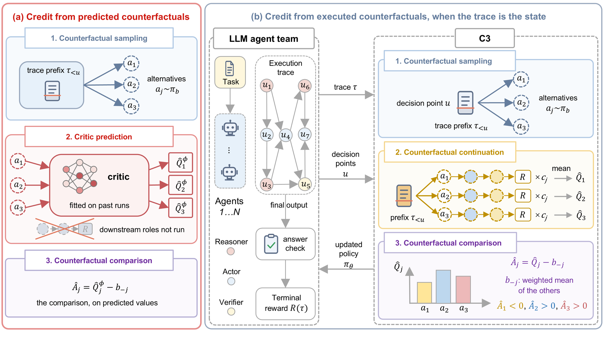

<div align="center">
  <picture>
    <source media="(prefers-color-scheme: dark)" srcset="figs/c3-logo-dark.svg">
    
  </picture>
  <h3>The Trace Is the State: Exact Credit Assignment for LLM Agent Teams</h3>
  <p><em>When the trace is the state, credit need not be predicted; it can be exact.</em></p>
  <p>
    <a href="https://arxiv.org/abs/2603.06859"></a>
    <a href="https://eit-east-lab.github.io/C3/"></a>
    <a href="LICENSE"></a>
    <a href="pyproject.toml"></a>
  </p>
</div>

## Overview

Train a team of LLM agents from a single terminal reward and you have to answer, for every message in the trace, how much it was worth. Credit assignment for such teams has mostly been treated as prediction: a learned critic, a trajectory-level score, or an agent ablation stands in for the counterfactual that defines credit, which is rarely run. Teams that communicate through a shared context are different: when everything a downstream agent reads is written into the trace, the trace is the state, and that counterfactual can be executed. **C3**, credit assignment by counterfactual continuation, substitutes one message at a decision point, continues the run to the terminal reward, and compares each alternative with the continuation-weighted mean return of the others. Its credit is unbiased, exact up to Monte Carlo error, and needs no learned parameters.

## Method

<div align="center">
  
</div>

**Figure 1**: Two ways to value an alternative message. (a) Credit from predicted counterfactuals: the decision point is not revisited, so a critic fitted on past runs predicts the value of each alternative. (b) Credit from executed counterfactuals, when the trace is the state: C3 resets the run to the trace prefix, substitutes an alternative message, runs the downstream roles to the terminal reward, and compares the mean reward of each alternative with the continuation-weighted mean of the other alternatives. Executed, not predicted: against a 16-continuation reference, C3 from 4 continuations reaches 0.69 rank correlation, and the critic reaches 0.29.

## Results

When the trace is the state, a credit signal can be judged as any estimator is: by bias, variance, and agreement with an independent reference. C3 is unbiased under that condition; on the other two criteria, and in training, the paper reports:

- **Agreement with a reference.** On the 2-agent chain, from 4 continuations, C3 ranks alternatives at **0.69** rank correlation against a 16-continuation reference, near the **0.73** at which 2 such references agree; a critic trained on the same rollouts reaches **0.29**.
- **Variance.** Given the sampled alternatives, the variance of each advantage estimate follows a derived law with no term for the number of agents; at the opening decision point of 6 workflows of 2 to 10 decision points, the observed variance is **0.90 to 1.07** times the law.
- **Training.** Used as the advantage in training a 2-agent team, C3 beats MAGRPO, the stronger baseline, by **+8.28** points on MATH500 over 5 training seeds (Holm-corrected p < 0.001).
- **Cost.** At a 2048-token generation limit, C3 spends **37%** fewer training tokens than MAPPO, since only the messages downstream of a decision point are regenerated.

The 5-seed run (Table 2 of the paper):

| Method | MATH500 | AIME 2025 | CMATH | GSM8K | Avg.† |
|:-|:-|:-|:-|:-|:-|
| MAPPO | 69.3 ± 0.9 | 3.3 ± 0.0 | 95.3 ± 0.2 | 92.9 ± 0.1 | 85.8 ± 0.3 |
| MAGRPO | 74.5 ± 0.4 | 5.3 ± 1.8 | 96.1 ± 0.2 | **93.4 ± 0.3** | 88.0 ± 0.1 |
| C3 | **82.8 ± 0.6** | **8.0 ± 1.8** | **96.3 ± 0.2** | **93.4 ± 0.2** | **90.9 ± 0.3** |

Qwen3-4B: greedy accuracy (%) under a 512-token generation limit, mean ± std over 5 training seeds on the 2-agent workflow; best value per column in bold, including ties at the printed precision. †Avg. is the mean of MATH500, CMATH and GSM8K; AIME 2025 (30 problems) is reported beside it, not inside it.

## Quickstart

This runs end to end on a laptop: no GPU, no checkpoints, no model weights.

```bash
python -m pip install -r requirements/cpu.lock.txt
python -m pip install -e . --no-deps
bash scripts/30_smoke/smoke.sh --task tests/fixtures/tasks/mini_math.yaml --limit 1 --print_example 0
```

The two installation tiers, data preparation and the GPU path are in [docs/00_getting_started.md](docs/00_getting_started.md).

## Reproducing the paper

[c3/utils/paper_train_contract.py](c3/utils/paper_train_contract.py) holds three training recipes, with the settings of Tables 5 and 6 and Appendix B.2 of the paper. [scripts/40_train/paper_train.sh](scripts/40_train/paper_train.sh) trains MAPPO, MAGRPO and C3 under one of them (GPU):

```bash
export PRETRAIN=Qwen/Qwen3-4B-Instruct-2507
RECIPE=main bash scripts/40_train/paper_train.sh   # Table 2: 2-agent workflow, 512 tokens, training seeds 0 to 4
RECIPE=long bash scripts/40_train/paper_train.sh   # Table 7: 2-agent workflow, 2048 tokens, training seed 0
RECIPE=a3   bash scripts/40_train/paper_train.sh   # Table 8: 3-agent workflow, 512 tokens, training seeds 0 to 4
DRY_RUN=1 RECIPE=main bash scripts/40_train/paper_train.sh   # print the command lines, start nothing
```

Each trained model is evaluated by [scripts/70_rebuild/final_eval.py](scripts/70_rebuild/final_eval.py) (GPU). On the CPU, `python -m c3.analysis.rebuild.aggregate_5seed` turns the records of the 5-seed runs into Tables 2, 8 and 10, and `python -m c3.analysis.rebuild.aggregate_e2` turns those of the long-generation run into Table 7 and its training-token account.

The measurements of Sections 3 and 4 run on a frozen policy: a driver under [scripts/70_rebuild/](scripts/70_rebuild/) generates the rollouts (GPU), and a module under [c3/analysis/rebuild/](c3/analysis/rebuild/) computes the numbers (CPU).

| Measurement | Generation (GPU) | Analysis (CPU) |
|---|---|---|
| Split-half reliability of 6 workflows (Table 1, Figures 2 and 3) | `e1_cells.py` | `aggregate_e1` |
| Signal and noise behind reliability (Table 1 Implied column, Table 3 lower block) | `e1_cells.py` | `e1_signal_noise` |
| Noise law on the grid of branching factors and continuations (Table 3 upper block) | `e1b_cells.py` | `aggregate_e1b` |
| Bias of agent ablation (Section 4, Appendix B.6, Table 9) | `e3a_cells.py` | `aggregate_e3a`, `e3a_strata` |
| Learned critic against C3 (Section 4, Appendix B.7) | `e4_reference_cells.py`; `e4_critic.py` `train` and `score` | `e4_critic.py` `split`, `prepare-reference` and `evaluate` |

Every driver takes `--dry-run`. The full command of each experiment, and the table each code name maps to, are in [scripts/70_rebuild/README.md](scripts/70_rebuild/README.md). The repository ships no data, checkpoints or results.

## Repository layout

- [c3/](c3/): Core C3 implementation: protocol, environments, credit assignment, analysis.
- [openrlhf/](openrlhf/): Vendored upstream RLHF training stack with C3 integration points.
- [configs/](configs/): Tasks, roles, analyses, execution registries and data manifests.
- [requirements/](requirements/): Lock files for the CPU tier, the GPU tier and the paper environment.
- [scripts/](scripts/): Entrypoints, numbered in the order a new user runs them.
- [tests/](tests/): Mechanism, contract and unit tests, with tiny fixtures.
- [project-page/](project-page/): Static companion site for the paper, deployed via GitHub Pages.

Documentation is under [docs/](docs/), numbered in reading order; its index is [docs/00_getting_started.md](docs/00_getting_started.md#quick-navigation).

## Citation

If you find this repository or paper useful for your research, please cite:

```bibtex
@misc{chen2026trace,
  title         = {The Trace Is the State: Exact Credit Assignment for {LLM} Agent Teams},
  author        = {Yanjun Chen and Yirong Sun and Hanlin Wang and Jinghan Wang and Xinming Zhang and Xiaoyu Shen and Wenjie Li and Wei Zhang},
  year          = {2026},
  eprint        = {2603.06859},
  archivePrefix = {arXiv},
  primaryClass  = {cs.LG},
  doi           = {10.48550/arXiv.2603.06859},
  url           = {https://arxiv.org/abs/2603.06859}
}
```

## License

- Code license: [Apache-2.0](LICENSE)
- Citation metadata: [CITATION.cff](CITATION.cff)
- Third-party notices: [THIRD_PARTY_NOTICES.md](THIRD_PARTY_NOTICES.md)
- Upstream provenance: [docs/40_upstream.md](docs/40_upstream.md)

## Acknowledgements

We deeply appreciate the open-source community for their foundational work. In particular, we would like to acknowledge:

- **[OpenRLHF](https://github.com/OpenRLHF/OpenRLHF)**: Our RL infrastructure is built upon the OpenRLHF framework. We are grateful to the OpenRLHF team for providing an easy-to-use, scalable, and high-performance agentic RL foundation based on Ray and vLLM.
